# OH_Node_V0_Prototype — open items before fab

Order: JLCPCB, all SMD assembled, THT by hand (docs/12 "Fabrication"). Relays switch **230 V mains**.
Datasheets in `OH_Node_V0_Prototype/datasheets/`. Items from the 2026-10-03 pre-fab review are closed (see git
history of this file); state of 2026-10-05: ERC clean, DRC 0 errors, 0 unconnected, parity clean.

## Layout review (external feedback, 2026-10-05)

Checked against the board of 2026-10-05; findings in italics.

- [x] Keep CLK traces at least 3 trace widths from other traces (see SCLK).
      _2026-10-05: DRC rule `clock_3w` (SCLK, I2S_BCLK, I2S_LRCLK to other signal tracks 0.4 mm, GND
      exempt). SPI and I2S bundles on B.Cu respaced to 0.2 mm tracks with 0.4 mm gaps around the clocks;
      GND via under U2's pad moved from (155.44, 84.0) to (153.7, 84.0), LRCLK/DIN vias nudged.
      After rerouting, the only hits were SCLK/SCSn and MISO/SCLK in U1's 0.5 mm pin fan-out (0.30 / 0.34 mm).
      DRC exclusions kept flipping (KiCad reports a different track pair each run and drops the others on save),
      so that spot is now the F.Cu rule area `clk_fanout_U1` (no keepout) and the rule skips it. No exclusions._
- [x] Lower the GND zone clearance and thermal settings to: clearance 0.2, minimum width 0.15, thermal relief
      gap 0.3, spoke width 0.3. _Now 0.5 / 0.25 / 0.5 / 0.5. The isolation, mains and PoE clearances come
      from `.kicad_dru` rules and stay in force._
      _Done 2026-10-05 (GND zone, all four layers). DRC after refill: no new errors; one new warning
      `connection_width` 0.0745 mm on the GND loop under U5 (167.55–169.05, 141.2), next to the +5V ends of
      the dangling-tracks item. The GND stub at Q2.1 now touches the pour and no longer reports as
      dangling; still remove it._

    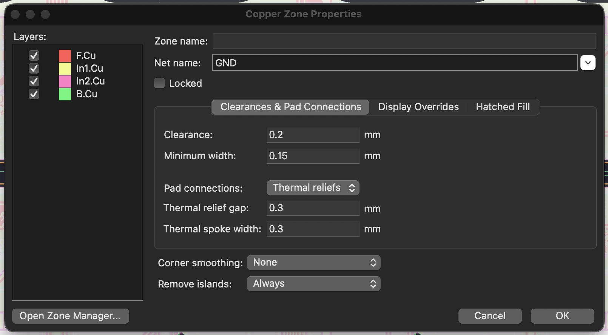

- [x] Keep distance to the Ethernet pairs; the +3V3A via also eats away the GND under the pair.
      _+3V3A vias at (114.30, 91.27) and (112.96, 93.98)._
      _Done 2026-10-05: via at (112.96, 93.98) and the F.Cu diagonal along ETH_TXT_P (4 mm at 0.30 mm) removed.
      R21/R42 are now fed on B.Cu (0.3 mm, x 114.5) from a new via on the y 100.4 trunk, with a new via at
      (114.5, 94.75) for R21. +3V3A vias now 0.65 / 0.81 / 3.5 mm from the nearest ETH track (was 0.15)._

    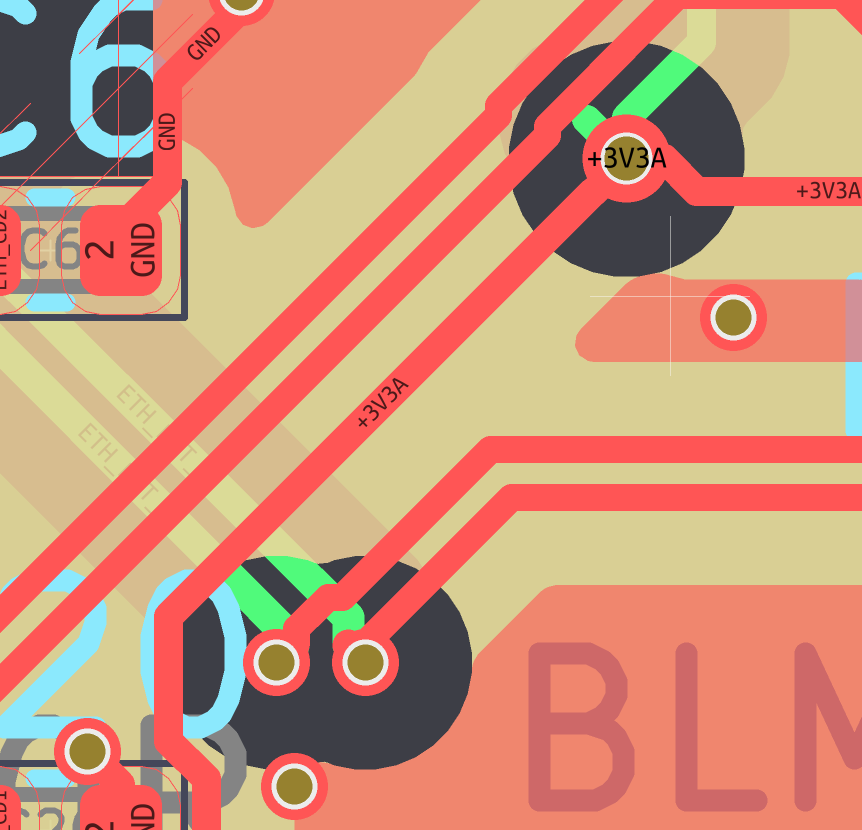

- [x] What are the caps in the Ethernet pair for? Is that circuitry the PHY asks for?
      _Checked 2026-10-05: C22/C23 (6n8) are the series caps on RXP/RXN from WIZnet's W5500 reference
      schematic (W5500-Ref-RJ45WithMag: C9/C10 6.8 nF, R6/R7 49R9 to C15 10 nF, TX 49R9 to 3V3A, TCT 10R to
      3V3A plus 22 nF). Ours matches value for value (R43/R44 49R9 + C30 10n, R21/R42 49R9, R4 10R + C20).
      They AC-couple the RX termination; WIZnet calls them mandatory when the magjack ties the centre taps
      together. J3 (7499511420) has separate CD1/CD2, so here they are not strictly needed but harmless
      (≈ 0.8 Ω at 30 MHz). Only deviations: RX centre tap CD2 goes to its own C6 100n instead of the 49R9
      midpoint, and TCT has 100n instead of 22n; both AC-ground the tap, no change. Pair polarity checked
      against the WE drawing: WE labels pin 11 "D1−" but it is cable pin 1 (TD+), pin 4 "D2−" is cable pin 3
      (RD+), so TXP→11 and RXP→4 are correct._
- [x] Stitching vias as close as possible to GND pads (without putting them in the pad).
      _Done 2026-10-05: 53 SMD GND pads had their nearest via > 1 mm away (31 > 2 mm, worst C2.2 18 mm, C5.2
      6.6 mm). 49 new GND vias (0.45/0.25, ≥ 0.25 mm from the pad, 0.25 mm track to the pad), placed by script
      and DRC-checked. Now 9 pads at 1.1–1.4 mm, none > 2 mm; U1.9/U1.14/U5.3/C9.2 have no free spot closer.
      Maps before/after: `OH_Node_V0_Prototype/analysis/2026-10-05_gnd/`, tool: `tools/gnd_reach/`._

    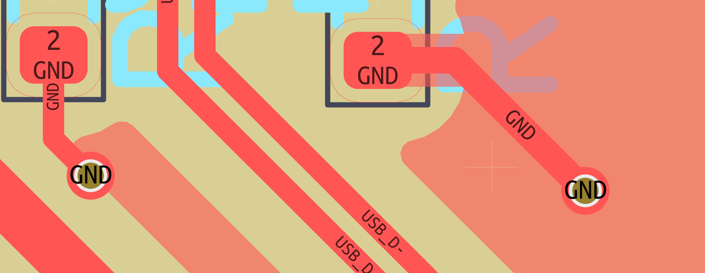

- [x] Compensate the skew in the USB pair with local meandering.
      _Done 2026-10-05: D+ was 0.61 mm longer (J11 → U2: 42.81 vs 42.20 mm; +0.44 at the bend behind J11,
      +0.29 at (136.6, 93.5), −0.12 at the U2 fan-out). Skew tuned on D− in KiCad; now both 42.812 mm.
      Uncritical anyway: the ESP32-S3 USB is Full Speed (0.6 mm ≈ 4 ps)._
- [x] Put the crystal's load caps into the signal path between chip and crystal.
      _Done 2026-10-05: Y1 moved right, C17/C18 vertical at x 133.7 between U1 and Y1; now U1.31 → C18 →
      Y1.3 → R15 and U1.30 → C17 → Y1.1 → R15, no stubs. GND side: C18.2 and Y1.2 got vias
      (pad to via 0.79 / 0.52 mm, was 10 mm through copper for C18.2); `starved_thermal` on C18.2 gone._

    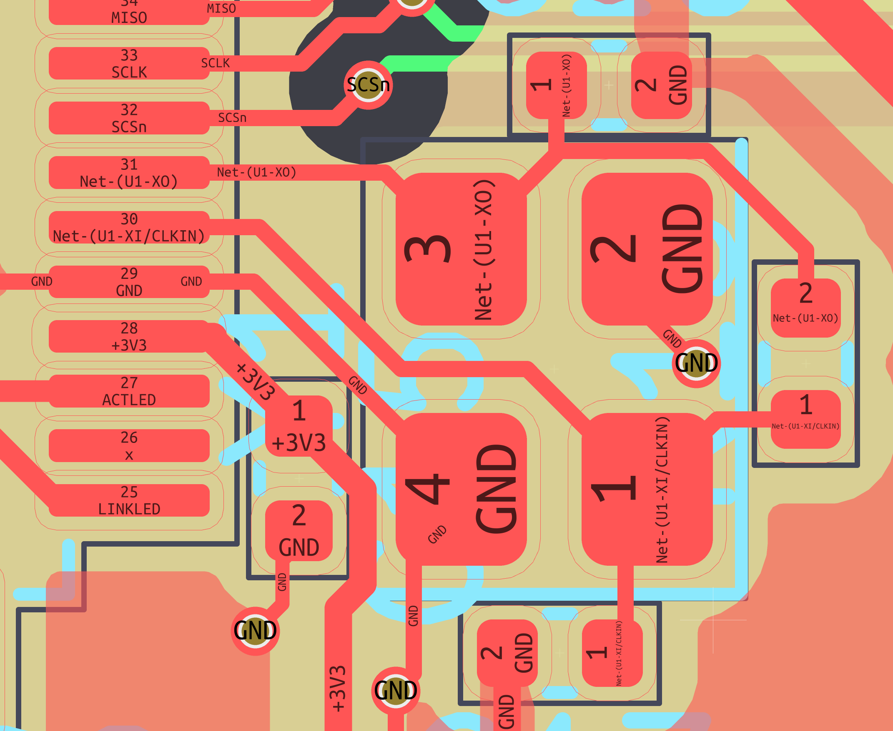

- [x] Replace traces narrower than 0.15 mm with wider ones; better avoid 0.15 too and use 0.2 as the
      minimum, which should fit everywhere on this board. _Net class Default is 0.13 mm._
      _2026-10-05: Default is 0.2 mm; 271 segments widened in place (to 0.2, or 0.175/0.15 where clearance
      stops it). DRC rule `min_track_width` 0.15 flags the rest: bundles RLY1–4, PIR1/2, GPIO1/2, LED_R/Y,
      I2S_LRCLK at U6, GND at Q1 — rerouted by hand 2026-10-05, `min_track_width` clean._

    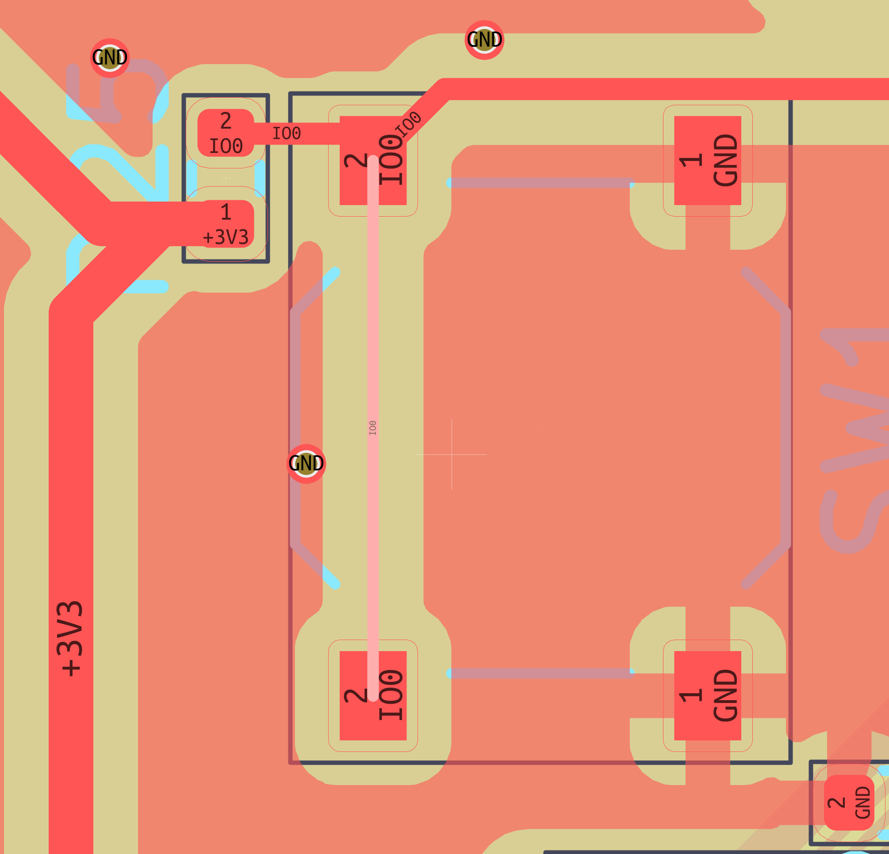

- [x] Add an input capacitor at the AMS1117 (there is none at the moment?). _Confirmed: no +5V capacitor
      within 12 mm of U3 pin 3; the nearest are C3/C4 at PS1. docs/12 "3.3 V: 10 µ in" is wrong._
      _Done 2026-10-05: C34 = Part-DB 593 CL21A226MAQNNNE (22 µ 25 V X5R 0805, LCSC C45783, same as C25) at
      (154.35, 111.65) on the +5V trunk, ≈ 3 mm from U3.3, GND via 0.7 mm from pad 2. docs/12 updated._
- [x] Trace not connected properly (K3 pad A1, track ends at the pad edge).
      _Fixed 2026-10-05: /K3_C 0.5 mm track now ends at the pad centre (120.81, 119.25)._

    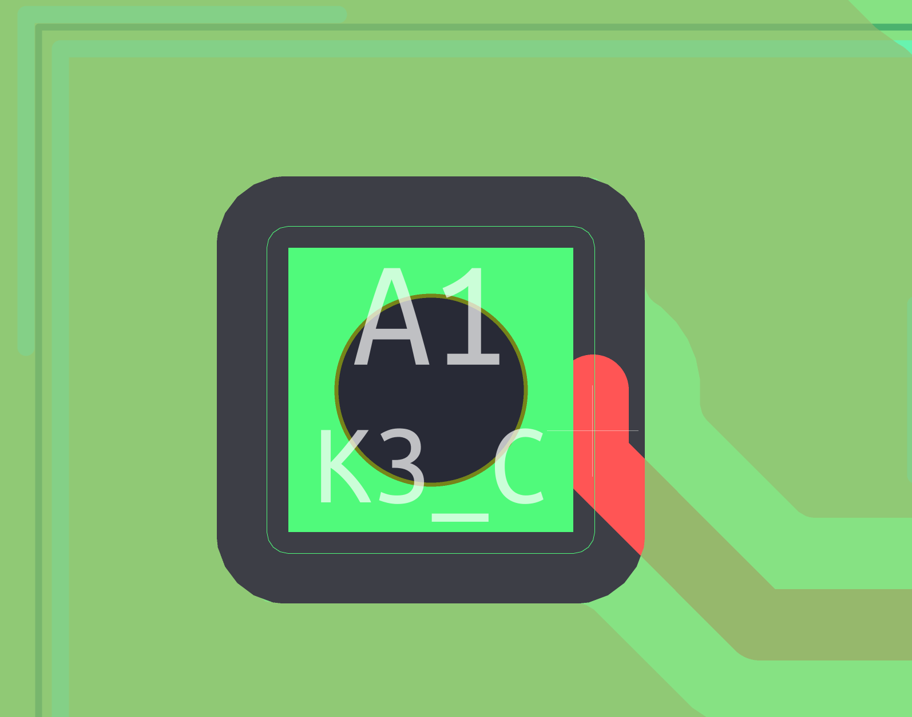

- [x] Add test points?
      _Decided 2026-10-05: yes, for +5V, +3V3, +3V3A, GND, /EN, /IO0 and UART0 TX/RX (U2.37 TXD0 / U2.36 RXD0
      now carry NC flags; replace them with labels). Stock `Connector:TestPoint` + `TestPoint:TestPoint_Pad_D1.5mm`,
      no Part-DB entry (deliberate exception: a bare pad, nothing to buy). The footprint is
      `exclude_from_pos_files exclude_from_bom` without `smd`, so `make_bom.py` already leaves it out.
      Done: TP1 +5V, TP2 +3V3, TP3 +3V3A, TP4 GND, TP5 /EN, TP6 /IO0, TP7 /RXD0, TP8 /TXD0; ERC 0, DRC clean._
- [x] USB diff pair and the Ethernet diff pair on the back side do not have the widths their net classes
      give. _Confirmed: USB 0.2 mm (class 90R 0.247), ETH RX on B.Cu 0.22 mm (class 100R 0.183)._
      _2026-10-05: the classes are right. JLC impedance calculator, JLC04161H-7628 (Standard, the stackup in the
      board): 90 Ω diff = 0.2474 / 0.1501, 100 Ω diff = 0.1826 / 0.1501 (L1 over L2; L4 the same by symmetry).
      (Earlier note calling them AISLER widths was wrong; AISLER is 0.260/0.135 and 0.220/0.150.)
      To do: re-route USB (whole pair, 0.20 → 0.247, then redo skew) and ETH_RXT on B.Cu (26.6 mm, 0.22 →
      0.183) with the diff pair router; the other ETH pairs are at 0.183 except 2 mm fan-out stubs._
      _Done 2026-10-05 (re-routed in KiCad): USB 0.247 / 0.15 (1 mm at 0.20 in the connector breakout), skew
      0.03 mm (42.80 / 42.84); ETH_RXT on B.Cu 0.183 / 0.15. DRC clean._
- [x] Move the ESP32 decoupling caps closer.
      _Done 2026-10-05: C32 (100n) now 1.5 mm and C31 (22u) 3.0 mm from U2.2 (were 5.6 / 4.0, 100n was the
      farther one); the +3V3 feed runs over C31.1 → C32.1 → U2.2, no stubs. GND pad to via 0.9 / 1.5 mm._
- [x] Put the TVS diode (D9) into the power path; at the moment it sits on branches.
      _Done 2026-10-05: VIN+ D11/D12 → D9.1 → PS1.4 and VIN− D11/D12 → D9.2 → PS1.5, 0.6 mm. Checked on the
      track graph: with D9's pads removed, neither bridge reaches PS1, so nothing bypasses the TVS._

    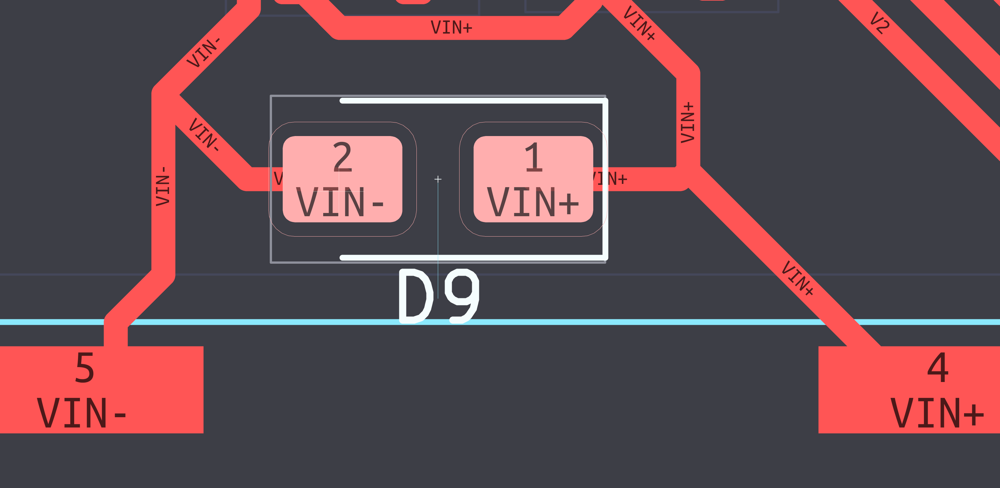

- [x] Ugly but harmless: a stray zone finger stays at the right-hand edge (top right corner, next to J12).
      _Done 2026-10-05: the strip lies between U2's antenna keepout (footprint, ends at x 179.435) and the board
      edge (x 180). Board-level rule area `antenna_edge` (all copper layers, no fill/tracks/vias, x 179.3–180.6,
      y 69.5–76.12) closes the gap; no GND fill left there after refill._

    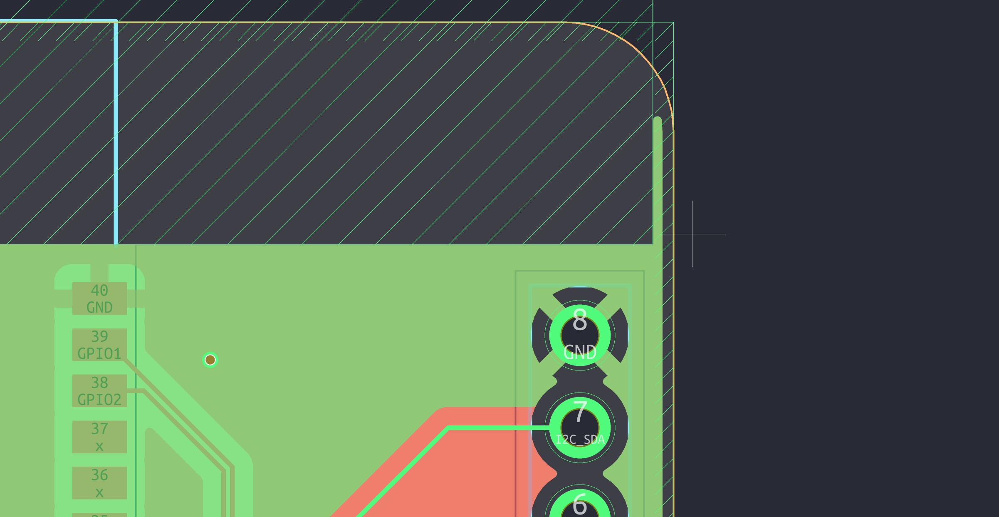

- [x] Three loose track ends (also DRC `track_dangling`): GND stub at Q2.1 (135.04, 116.49), remove;
      +5V 0.66 mm at (171.38, 141.62) with its horizontal piece, remove; +5V 3.89 mm at (170.00, 139.09)
      feeds U4/U5, **do not delete**, move its end to (172.20, 136.34) on the vertical track.
      _Done 2026-10-05: both stubs removed; the U4/U5 feed now goes 45° to (172.20, 136.89) and straight up into
      the end of the vertical track at (172.20, 136.34). DRC: no `track_dangling` left._

    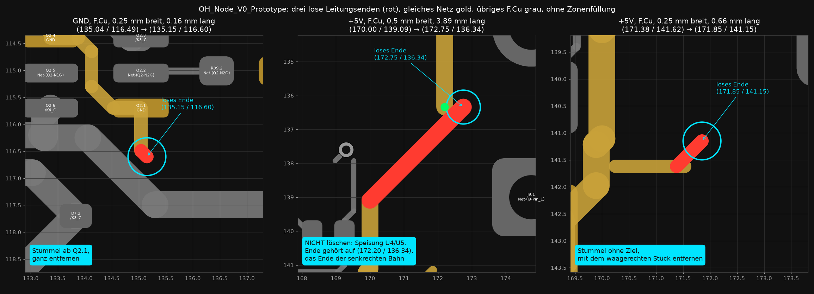

- [x] Change supply layers with more than one via (e.g. 2). _Single vias: +5V at (119.19, 90.6) D10 → B.Cu,
      (126.44, 107.1) B.Cu → 1.5 mm backbone, (136.54, 79.35) → U6; +3V3 at (131.24, 89.8) and
      (140.14, 80.6)._
      _Done 2026-10-05: second via (same 0.6/0.3) 0.9 mm beside each of the five, tied in on F.Cu and B.Cu with
      0.5 mm links: +5V (127.34, 107.10), (137.44, 79.35), (120.09, 90.60); +3V3 (141.04, 80.60), (132.14, 89.80).
      Left single: three +3V3A vias of the R21/R42 bias feed (114.5/114.3, 91.3–100.4), a few mA only._

    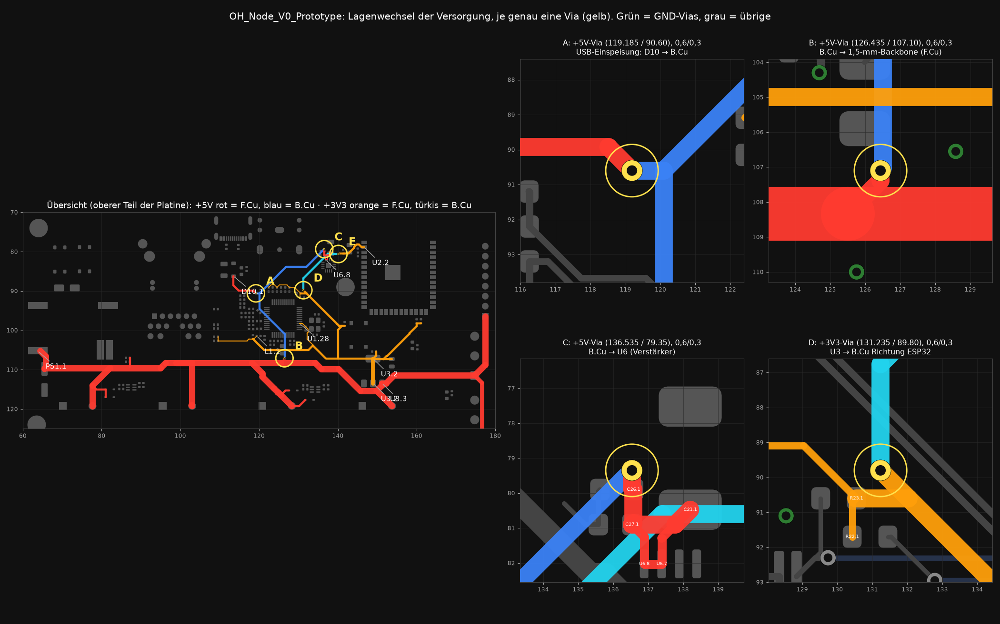

- [x] Connect at least two mounting holes to GND. _H1–H4 have no net now._
      _Done 2026-10-05: enclosure is 3D-printed plastic, so no chassis to bond to. H1/H2/H4 are now
      `MountingHole_Pad` with a 0R DNP to GND (R47/R48/R50, Part-DB 598, GND via 0.7–1.0 mm from pad 2): fit them
      for a metal enclosure. H3 (64, 74) stays unconnected on purpose: it sits on the PoE side of the barrier,
      3.5 mm from /V2 and 28 mm from the nearest GND; in a metal enclosure it must not be bonded either._

### Stitching

- [x] GND stitching with via arrays at every GND connection of the connectors and at the PoE module.
      _Done 2026-10-05 together with the item below: the connector GND pins are plated through-holes and tie the
      layers themselves; PS1 pad 2 sits under the module keep-out (no vias allowed, datasheet Fig. 17), the
      stitching vias sit right below it; J11 has its GND pad vias from the pad pass._
- [x] At least 2 stitching vias wherever signals change layers.
      _Done 2026-10-05: 37 GND return vias placed by script, then the SPI via columns at U1 and the ESP32 were
      loosened by hand around marker vias. Of 53 signal vias, 50 now have a GND via within 1.2 mm (5 at the
      start), 16 have two; median distance 0.75 mm (was 3.1). The rest (ACTLED, LINKLED, RLY3, all slow) have one
      at 1.3–1.5 mm. DRC clean. List: `OH_Node_V0_Prototype/analysis/2026-10-05_gnd/return_vias.csv`
      (state after the script, before the manual pass)._
- [x] At the end, stitch the whole board with the via stitching plugin, e.g. with these settings:
      _Done 2026-10-05 by script with the plugin's settings (GND, 0.6/0.3, hexagonal 5 mm, avoid other zones and
      GND pads) plus a gap pass: 209 vias, each inside the GND fill on all four layers, DRC-checked. First the
      +12V run to F1/F2 moved down to y 126.0 (mains_to_selv limit), which removed a 0.5 mm GND sliver and an
      island with no via. Max path through copper to a GND via: F.Cu 55.8 → 10.1 mm, B.Cu 29.0 → 10.6 mm. Maps:
      `OH_Node_V0_Prototype/analysis/2026-10-05_gnd/after_stitching/`._

    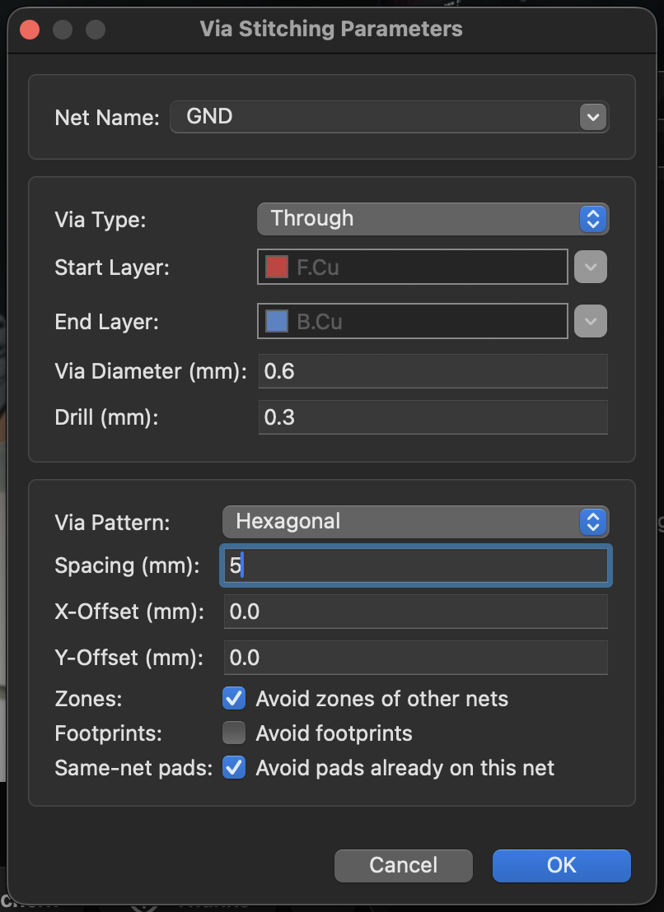

## Minor

- [x] DRC silkscreen warnings: 149 overlaps, 117 over copper, 9 at the board edge. Cosmetic.
      _Done 2026-10-05: cleaned up in the board; 6 `silk_edge_clearance` hits at the top edge (y 70, x 120.7–129.7)
      excluded. DRC now reports nothing at all, parity clean._
- [x] 12V für Bewegungsmelder wie? und passt das mit Kontakt, der zu GND schließt
      _2026-10-05: decided — V0 moves to the product power path (docs/10 D37 amendment): AG9912-MTB 12 V +
      AP63205WU-7 buck to 5 V; J8/J10 carry 12 V through PPTCs F1/F2; inputs get a 10K pull-up at the terminal
      and 10K series, so a contact to GND (NO/NC) works. Schematic done, ERC 0. Layout done
      2026-10-05: buck under PS1 (C35 at VIN/GND, SW 0.6 mm, +5V out 1.0 mm), +5V trunk rerouted around J8/J10,
      F1/F2 at the terminals; DRC 0 errors, parity clean. Check: LCSC numbers on Part-DB AP63205WU-7 (C2071056)
      and SWPA6045S4R7MT (C78804) before generating the BOM._

## Last step

- [x] **Order files are stale.** `production/jlc_final/` was generated 2026-10-01; parts and routing have
      changed since. Regenerate gerbers, drill, `positions.csv` and `bom.csv` after the items above. New in the
      BOM since 2026-10-03: C21 (GRM31CR61A107MEA8L, LCSC C883598), Q1/Q2 DMN2004DWK-7 (C156343, was
      C156344), D1 KT-0603Y (C2287), D2 KT-0603R (C2286), R45/R46 1K, C34 (CL21A226MAQNNNE, C45783, same line as C25); R20 is DNP.
      _Regenerated 2026-10-05 in `production/jlc_final/` (see its README): plugin CLI for gerbers/CPL,
      `make_bom.py` for the BOM, 102 SMD parts / 41 lines, all with LCSC numbers; BOM == CPL designators.
      `make_bom.py` fixed: footprints without an (attr) line (test points) made it drop C18, D12, R41, U4, Y1.
      Q1/Q2 LCSC C156343 added to Part-DB._
- [ ] JLC placement preview: confirm polarity and pin 1 of C2, D1, D2, D9, D10, D11/D12, Q1/Q2, U1, U3, U4/U5, U6, U7,
      J11, Y1 after uploading the new CPL.
